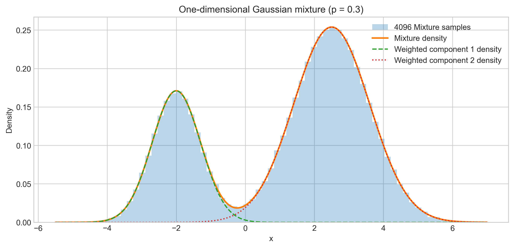
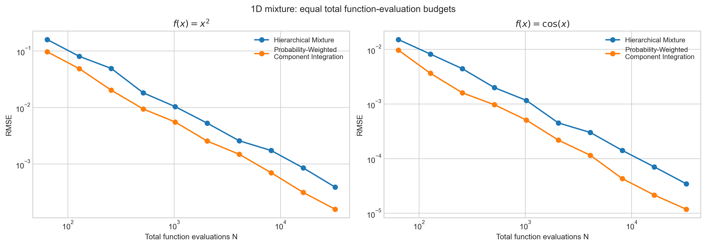
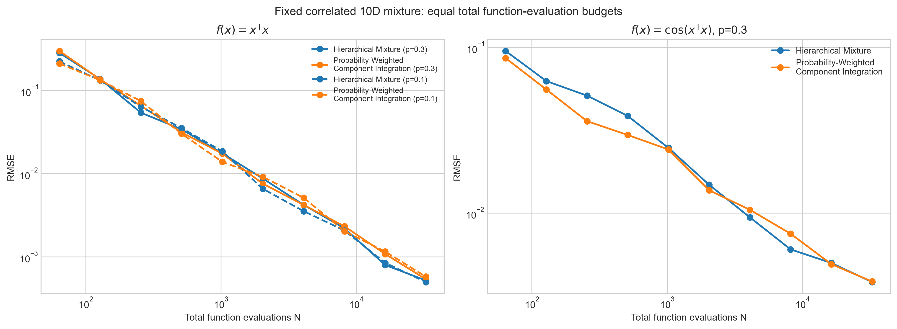
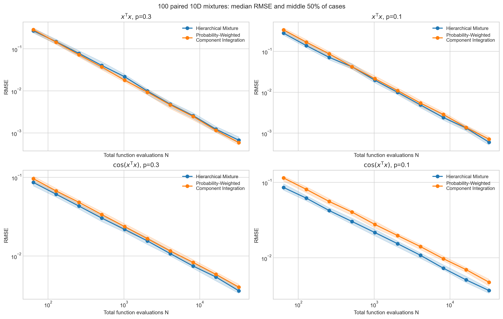

## Introduction

Many simulation problems involve observations from different sources, each with its own behavior. A manufacturing process may use two types of machines to produce the same product. Although both perform the same task, their output measurements may follow different probability distributions. Treating all output as one homogeneous population can obscure those differences. Estimating quantities such as the proportion of products outside an acceptable tolerance therefore requires accounting for each machine type's behavior and its contribution to production.

Mixture distributions combine these component distributions into a single model while preserving their distinct behaviors. Once the mixture is defined, two practical questions arise: How can we generate samples that represent the overall distribution? And if our goal is to estimate an expected value, can we instead work with the individual components and combine their results?

QMCPy's new `Mixture` class addresses the first question through **Hierarchical mixture sampling**, where a component is selected according to its probability before an observation is generated. An alternative for estimating expectations is **Probability-weighted component integration**, which estimates the expected value within each component separately and combines the estimates using the component probabilities. This article introduces QMCPy's mixture sampling functionality, compares the two approaches at equal computational cost, and discusses when each is useful.

## Understanding Mixture Distributions

The Gaussian examples below illustrate the computational approaches; they are not a manufacturing case study.

The numerical example uses two Gaussian components with means $-2$ and $2.5$, standard deviations $0.7$ and $1.1$, and selection probabilities of 30% and 70%, respectively. Each observation is generated by selecting a component according to its probability and drawing from that Gaussian. The observation comes from one component; it is not an average of component draws. These probabilities are illustrative; other positive mixture weights summing to one are equally valid.

{#fig-mixture-density fig-alt="Two Gaussian clusters near minus 2 and 2.5; the second has greater probability weight." width=100%}

The two clusters come from the two Gaussians. The weighted density curves have areas $0.3$ and $0.7$, and their sum is the full mixture density. The sample reflects those target probabilities without needing exactly 30% of its observations in the first component.

The [QMCPy framework paper](https://joss.theoj.org/papers/10.21105/joss.09705) and [Quasi-Monte Carlo Software](https://link.springer.com/chapter/10.1007/978-3-030-98319-2_2) describe the separation between uniform sampling and probability transformations; [Finite Mixture Models](https://onlinelibrary.wiley.com/doi/book/10.1002/0471721182) provides broader statistical background.

## Generating mixture samples

**Hierarchical sampling** in `Mixture` reuses the selected component's existing transform.

For $d$-dimensional components, QMCPy supplies $d$ uniform coordinates for the selected transform and one additional coordinate, $V$, for component selection. In the Gaussian example, $V$ partitions the unit interval at $p=0.3$: values below the threshold select the first Gaussian transform, $T_1$; values above it select the second, $T_2$.

In `Mixture`, $V$ is the **first** sampler coordinate. The driver is $(V,U_1,\ldots,U_d)$, so its dimension is $d+1$, while the output remains $d$-dimensional. The selector is consumed, not returned as part of the observation.

The one-dimensional construction uses the following public API:

```python
from qmcpy import DigitalNetB2, Gaussian, Mixture

components = [
    Gaussian(
        DigitalNetB2(1, seed=11, randomize="LMS DS"),
        mean=-2.0, covariance=0.7**2,
    ),
    Gaussian(
        DigitalNetB2(1, seed=13, randomize="LMS DS"),
        mean=2.5, covariance=1.1**2,
    ),
]
mixture = Mixture(
    DigitalNetB2(2, seed=7, randomize="LMS DS"),
    components, [0.3, 0.7],
)
samples = mixture(4096)
print(samples.shape)  # (4096, 1)
```

The result contains 4096 one-dimensional observations, generated from two-dimensional uniform points. `Mixture` uses the selected component's transform; it does not draw additional points from that component's attached sampler.

Components must have a common output dimension. The initial scope covers direct, dimension-preserving component transforms, not nested mixtures or arbitrary composed importance-sampling transforms. The [demo](https://github.com/QMCSoftware/qmcpy/blob/develop/demos/mixed_distributions.ipynb) and [implementation](https://github.com/QMCSoftware/qmcpy/blob/develop/qmcpy/true_measure/mixture.py) provide the technical usage details.

## Two approaches to expectation estimation

Generating samples and estimating an expectation are related but distinct tasks. A common goal is the average of a quantity $f(X)$, such as a squared magnitude or a cost. This expectation can be estimated from mixture samples or calculated within each component and combined.

**Component integration** computes the component expectations separately and combines them using the mixture probabilities. For two components, the estimate is

$$
\widehat I
  =p\,\widehat I_1+(1-p)\,\widehat I_2,
$$

where $\widehat I_1$ and $\widehat I_2$ estimate the averages within the two components. At $p=0.3$, the weights remain $0.3$ and $0.7$.

This distinction is also relevant to QMC. With the transform coordinates $U$ fixed, moving $V$ across $p$ changes the selected transform from $T_1$ to $T_2$, so the output can jump. Even when $f$ is smooth, its value after transformation can therefore be discontinuous in the selector coordinate.

QMC uses structured points to cover a uniform domain. A jump can affect the numerical benefit of that coverage, but its presence alone does not determine the integration error. Component integration removes this particular discontinuity because each calculation uses only one transform. Comparing the approaches at equal computational cost helps establish whether this difference improves accuracy and clarifies their practical uses.

For broader context, see [Lemieux (2009)](https://link.springer.com/book/10.1007/978-0-387-78165-5) and [He and Wang (2015)](https://epubs.siam.org/doi/10.1137/15M1007963). The comparisons below provide finite-budget numerical evidence rather than a theoretical convergence-rate result.

## An equal-cost comparison

The computational budget $N$ counts the total number of evaluations of $f$. Hierarchical sampling uses $N$ points, each producing one mixture observation and one evaluation. Component integration uses $N/2$ points in each component, then combines the two estimates.

For example, at $N=1024$, hierarchical sampling makes 1024 evaluations. Component integration makes $512+512=1024$. This compares equal evaluation budgets, not $N$ mixture observations against $N$ observations *per component*, which would give the latter twice the work.

The equal split does **not** make the mixture probabilities $1/2$ and $1/2$. It only allocates computational effort. Both calculations still estimate the same 30%/70% mixture expectation.

This allocation is not assumed to be optimal. One component might merit more effort because its transformed function varies more or costs more to evaluate. Equal cost here means equal numbers of function evaluations, not identical elapsed time.

## Experimental setup

All comparisons use randomized `DigitalNetB2` with `randomize="LMS DS"`: linear matrix scrambling and digital shift. Total budgets run from 64 to 32768, doubling each time. We use 32 independent randomizations and analytical reference expectations.

**RMSE**, or root mean square error, summarizes the deviation of the 32 estimates from the analytical reference: it is the square root of their mean squared error. Smaller RMSE indicates greater accuracy by this measure.

An **empirical slope** summarizes the decline of RMSE on a log-log plot. Each slope is fitted over the largest five budgets, from 2048 to 32768. More negative slopes indicate faster observed error reduction over that range; they are not theoretical or guaranteed long-run rates.

The methods use the same Gaussian means and covariances. Comparisons are paired by mixture instance, **not by identical QMC points**: hierarchical sampling has a $d+1$-dimensional driver, while component integration uses $d$-dimensional drivers and method-specific seeds. Where applicable, each method reuses its own randomized construction across probabilities and evaluates both functions on its generated samples.

Gaussian transforms use QMCPy's default PCA covariance factorization. These public-API calculations put $V$ first; the older exploratory demo used another coordinate ordering and covariance factors. Their finite-budget errors can differ even though the target distributions agree.

The numerical source is `demos/mixed_distributions_blog_analysis.ipynb`.

<!-- TODO before publication: add a stable public link to demos/mixed_distributions_blog_analysis.ipynb once it is available in the QMCPy repository. Do not substitute the exploratory demo's outputs. -->

## One-dimensional results

The one-dimensional comparison estimates the averages of $x^2$ and $\cos x$ for the illustrated mixture. Both functions are smooth. Their analytical expectations are $6.569$ and approximately $-0.4039548336$.

{#fig-equal-cost-1d fig-alt="Both RMSE curves decrease strongly in each panel; component integration has the lower final error." width=100%}

::: {.table-responsive}

| Function | Hierarchical sampling RMSE | Component integration RMSE |
|---|---:|---:|
| $x^2$ | 3.87349e-4 | 1.57216e-4 |
| $\cos x$ | 3.44654e-5 | 1.17855e-5 |

: Final RMSE at $N=32768$. {#tbl-1d}

:::

Both curves show substantial error reduction as the budget grows, with fitted slopes near -1 for both functions. Component integration has lower final RMSE for both functions, while hierarchical sampling also reduces error effectively despite the selector jump. Results for two functions under one mixture do not establish a general ranking.

## Correlated Gaussian components

The higher-dimensional cases use five- and ten-dimensional Gaussians with non-diagonal covariance matrices and correlated coordinates. The quadratic function $x^\mathsf T x$ is the sum of squared coordinates.

We also test $\cos(x^\mathsf T x)$: a smooth, bounded but oscillatory function. Analytical Gaussian identities supply the references for both functions; [Khatri (1980)](https://doi.org/10.1016/S0169-7161(80)80044-7) provides background on quadratic forms in normal variables. The analysis notebook contains their evaluation and the independent Monte Carlo sanity check; the reference calculation is not a third method in our QMC comparison.

::: {.table-responsive}

| Case | Hierarchical sampling RMSE | Component integration RMSE |
|---|---:|---:|
| 5D quadratic, $p=0.3$ | 3.49064e-4 | 3.19178e-4 |
| 10D quadratic, $p=0.3$ | 5.18152e-4 | 5.35768e-4 |
| 10D quadratic, $p=0.1$ | 4.95480e-4 | 5.75095e-4 |
| 10D cosine quadratic, $p=0.3$ | 3.82541e-3 | 3.85641e-3 |

: Final RMSE at $N=32768$. The two 10D probabilities use the same components. {#tbl-fixed}

:::

{#fig-fixed-10d fig-alt="Quadratic RMSE falls more steeply than cosine-quadratic RMSE; the methods finish with similar errors." width=100%}

Final RMSEs are much closer in these cases. Quadratic errors decline more steeply than cosine-quadratic errors, but neither method consistently has smaller final RMSE. Variation among individual cases motivates a larger paired study.

## One hundred paired random 10D mixtures

The paired study uses 100 pairs of dense, correlated 10D Gaussian components. Each pair is tested at $p=0.3$ and $p=0.1$, using both functions. The two methods share the same component means and covariances, while each retains its own randomized QMC construction across the comparisons.

The table reports median final RMSE across these 100 cases. Slope summaries below are medians of the individual fitted slopes, not fits to the median RMSE curve; complete slope results remain in the analysis notebook.

::: {.table-responsive}

| Function and probability | Hierarchical sampling RMSE | Component integration RMSE |
|---|---:|---:|
| $x^\mathsf T x$, $p=0.3$ | 6.68635e-4 | 5.86504e-4 |
| $x^\mathsf T x$, $p=0.1$ | 5.96696e-4 | 7.10812e-4 |
| $\cos(x^\mathsf T x)$, $p=0.3$ | 3.60423e-3 | 4.01285e-3 |
| $\cos(x^\mathsf T x)$, $p=0.1$ | 3.68671e-3 | 4.74773e-3 |

: Median final RMSE at $N=32768$, under equal evaluation budgets. {#tbl-random}

:::

{#fig-random-10d fig-alt="The methods have similar slopes within each panel, with steeper decay for the quadratic integrand and overlapping interquartile bands." width=100%}

The shaded bands contain the middle 50% of RMSEs across mixture instances. They show variability between cases, not confidence intervals for the median. Their overlap underscores that an ordering of medians need not hold in every case.

For the quadratic function, component integration has a modest median final-error advantage at $p=0.3$, while hierarchical sampling has lower median final RMSE at $p=0.1$. The median fitted slopes are close to -1 for both methods at both probabilities.

For the cosine-quadratic function, hierarchical sampling has smaller median final RMSE at both probabilities. Both methods have fitted slopes around $-0.5$, consistent with the slower behavior in the fixed nonlinear example.

The strongest observed slope change comes from changing the function, not from changing $p$ between $0.3$ and $0.1$. Probability still affects finite-budget errors. However, the selector discontinuity alone does not explain the contrast between the two functions, and these results do not support universally preferring component integration.

## Practical uses

The appropriate construction depends on the required output as well as numerical accuracy.

::: {.table-responsive}

| Goal | Practical distinction |
|---|---|
| A sample set from the whole mixture | hierarchical sampling produces it directly |
| An expectation | component integration combines the component estimates; hierarchical sampling also works |
| Separate control of component effort | component integration allows explicit allocation |

: These distinctions are not a universal accuracy ranking. {#tbl-practical}

:::

Hierarchical sampling is useful for visualizations, quantiles, downstream simulation, or several statistics from one sample set. `Mixture` makes the distribution itself reusable as one QMCPy probability model.

Component integration is useful when the expectation is the required answer and the components can be evaluated separately. It avoids the selector jump and allows explicit per-component budgets. It is not itself a direct mixture-sampling construction, and removing this jump does not remove every difficulty in a transformed integral.

The equal $N/2$ split is a benchmarking baseline, not an optimized component allocation. Coordinate ordering and Gaussian factorization can also affect QMC errors without changing the distribution. Improved allocation and alternative QMC mappings are natural directions for further study.

## Conclusion

`Mixture` represents finite mixture distributions as reusable QMCPy probability models. Hierarchical sampling directly generates observations from the whole model; component integration offers another formulation for expectation estimation.

Under equal work, neither method universally dominates. Component integration has smaller final errors in the one-dimensional examples, while the higher-dimensional comparisons depend on the function and mixture probability. The selector discontinuity matters to the construction, but does not by itself determine the observed performance.

The reported slopes and errors are finite-budget numerical observations, not theoretical convergence rates or a theorem.

## Acknowledgments

I thank Fred J. Hickernell for guidance and discussions throughout this work, Aleksei G. Sorokin for code-review and documentation feedback, and Sou-Cheng T. Choi for implementation and review feedback. Discussions on [QMCPy issue #610](https://github.com/QMCSoftware/qmcpy/issues/610) helped clarify the relationship between hierarchical sampling and component integration.

## References

1. Sorokin, A. G., Hickernell, F. J., Choi, S.-C. T., Rathinavel, J., Robbe, P., & Jain, A. (2026). [QMCPy: A Python Framework for (Quasi-)Monte Carlo Algorithms](https://doi.org/10.21105/joss.09705). *Journal of Open Source Software*, 11(117), 9705.

2. Choi, S.-C. T., Hickernell, F. J., Rathinavel, J., McCourt, M. J., & Sorokin, A. G. (2022). [Quasi-Monte Carlo Software](https://doi.org/10.1007/978-3-030-98319-2_2). In *Monte Carlo and Quasi-Monte Carlo Methods: MCQMC 2020*, pp. 23–47. Springer Proceedings in Mathematics & Statistics, vol. 387.

3. Lemieux, C. (2009). [*Monte Carlo and Quasi-Monte Carlo Sampling*](https://doi.org/10.1007/978-0-387-78165-5). Springer Series in Statistics.

4. McLachlan, G., & Peel, D. (2000). [*Finite Mixture Models*](https://doi.org/10.1002/0471721182). Wiley.

5. He, Z., & Wang, X. (2015). [On the Convergence Rate of Randomized Quasi-Monte Carlo for Discontinuous Functions](https://doi.org/10.1137/15M1007963). *SIAM Journal on Numerical Analysis*, 53(5), 2488–2503.

6. Khatri, C. G. (1980). [Quadratic Forms in Normal Variables](https://doi.org/10.1016/S0169-7161(80)80044-7). In *Handbook of Statistics*, vol. 1, pp. 443–469. North-Holland.

Project resources: [QMCPy](https://github.com/QMCSoftware/qmcpy), [issue #610](https://github.com/QMCSoftware/qmcpy/issues/610), [PR #615](https://github.com/QMCSoftware/qmcpy/pull/615), and the [mixed-distributions demo](https://github.com/QMCSoftware/qmcpy/blob/develop/demos/mixed_distributions.ipynb).
